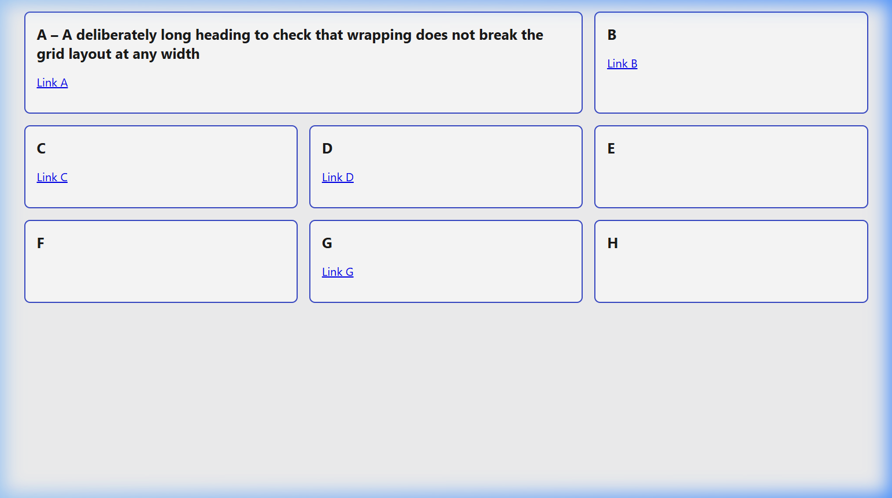
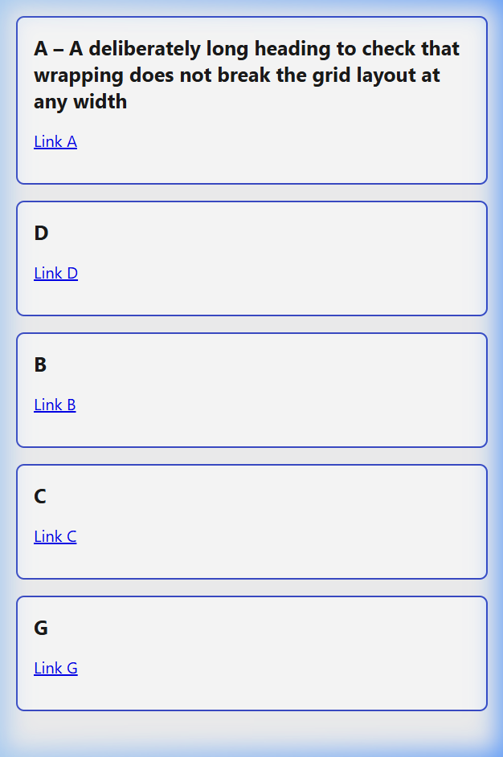
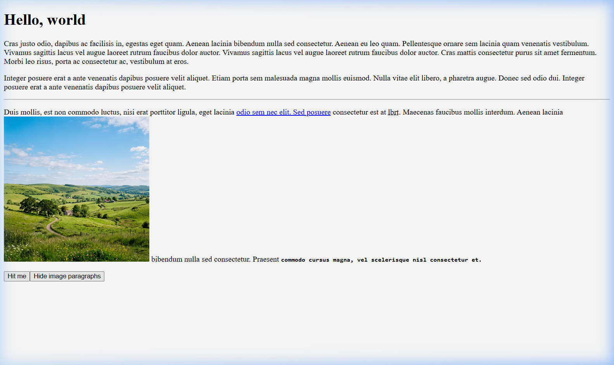

# BCM Software Developer Test

**Candidate:** Owolabi Quadri &nbsp;|&nbsp; **Date:** October 2026

Each question has its own section below, and each one starts with a short summary. The code is in the folders listed in the table, and the screenshots and test output are in `evidence/`.

## Status at a glance

| Q | Topic | Where | Evidence | Status |
|---|---|---|---|---|
| 1 | PHP / WordPress query | `q1-php/search-template.php` | Each case traced through the code; template passes `php -l`; test plugin included. **Not run on live WordPress** | Done (reasoned, not executed) |
| 2 | Editor can't upload images | This file | Written answer | Done |
| 3 | Slow article page | This file | Written answer | Done |
| 4 | CSS layout | `q4-css/` | `evidence/q4-desktop.png`, `evidence/q4-mobile.png` | Done |
| 5 | HTML correction | `q5-q6-html-js/index.html` | `evidence/q5-validator.json` (no errors or warnings) | Done |
| 6 | JavaScript behaviour | `q5-q6-html-js/script.js` | `evidence/q6-test-output.txt`, `evidence/q6-on-load.png` | Done, automated test passes |
| 7 | Stale article after release | This file | Written answer | Done |
| 8 | Editor workflow | This file | Written answer | Done |
| 9 | Newsletter signup reliability | `q9-api/signup.js` | `evidence/q9-test-output.txt` | Done, tests pass |
| 10 | Endpoint security review | This file | Written answer | Done |

## Contents

1. [PHP](#1-php)
2. [Editor can't upload images](#2-editor-cant-upload-images)
3. [Slow article page on mobile](#3-slow-article-page-on-mobile)
4. [CSS layout](#4-css-layout)
5. [HTML](#5-html)
6. [JavaScript](#6-javascript)
7. [Readers seeing an old version after a release](#7-readers-seeing-an-old-version-after-a-release)
8. [Making it easier for editors to share articles](#8-making-it-easier-for-editors-to-share-articles)
9. [Newsletter signups without duplicates](#9-newsletter-signups-without-duplicates)
10. [Reviewing the status-change endpoint](#10-reviewing-the-status-change-endpoint)
11. [Use of AI](#use-of-ai)

## How to run things

| What | Command |
|---|---|
| Q4 and Q5/Q6 pages | Open the `index.html` file in a browser. For Q4, resize the window past 768px |
| Q6 automated check | `cd tests && npm install && node q6-test.js` (Node 18+) |
| Q9 tests | `node q9-api/signup.js` (Node 18+) |
| Q1 | Copy `search-template.php` into a theme and use it as a page template |

---

## 1. PHP

**Summary:** The snippet wouldn't run at all, because `WP_Query` is called without `new`. Even with that fixed, the pagination, title output and ad replacement were all broken. The regex in particular would have replaced every letter "a" and "d" in every post.

Here's what I found, roughly in the order you'd hit them:

| Problem | What happens | Fix |
|---|---|---|
| `WP_Query([...])` with no `new` | Fatal error | `new WP_Query(...)` |
| `'page' => $page` | WordPress wants `paged` for archive-style queries, so every page shows page 1 | Use `'paged'` |
| `$_GET['page']` used as-is | `?page=abc` or `?page=-1` goes straight through, and it's echoed into the `<h1>` unescaped | `max(1, absint(...))` |
| `$_GET['s']` read with no fallback | Undefined index warning when there's no search, and passing `null` into string functions is deprecated from PHP 8.1 | `sanitize_text_field(wp_unslash($_GET['s'] ?? ''))` |
| `$pages` never set | Warning, and the heading reads "Page 1 of " | `$q->max_num_pages` |
| `<h1>` is never closed | Everything after it, including every post, ends up inside the heading | Added `</h1>` |
| Regex `#[ad]#` | Square brackets make a character class, so this matches any single `a` or `d` | `#\[ad\]#` |
| Callback uses `echo` | The divs are printed above the post, and the marker is replaced with nothing | `return` the HTML instead |
| `$m` used but never passed in (and no capture group) | Undefined variable, so you get `class="ad ad-"` | Take `$m` as the argument and use a counter for the number |
| `esc_html(the_title())` | `the_title()` echoes the raw title and returns nothing, so the escaping does nothing | `esc_html(get_the_title())` |
| `get_the_content()` printed raw | Shortcodes, blocks and paragraphs aren't processed | Run it through `the_content` filters |
| Content wrapped in `<p>` | Post content already contains block elements, so this nests `<p>` inside `<p>` | Use a `<div>` |
| No `wp_reset_postdata()` | Anything after the loop sees the wrong global `$post` | Added |
| Nothing for zero results | An empty search just shows a blank page | Added a "No posts found" message |

**Assumptions about the ad placeholders**
- The marker is always the literal text `[ad]`, with no attributes and the same case.
- Each one becomes `<div class="ad ad-1"></div>`, `ad-2` and so on, counting across the whole page, so the ad script can tell the slots apart.
- I replace markers *after* `the_content` filters run, otherwise `wpautop` can wrap the div in a `<p>`.

**Checks, traced through the corrected code**

I haven't run this on a live WordPress site, so the results below come from reading through the code for each case. I did check the template with `php -l`, and I've included a small test plugin (`q1-php/q1-test-plugin.zip`) that creates sample posts and shows the template at `/?q1_test=1`, so anyone can try these cases in a few minutes.

| Case | What the code does | Result |
|---|---|---|
| **Missing parameters** (`/`) | `$_GET['page']` isn't set, so `$page` is 1. `$_GET['s']` isn't set, so `$search` is `''`. `WP_Query` gets an empty `s`, which WordPress ignores, so it returns the latest posts | "Page 1 of N", 10 posts, no undefined-index warnings, and no ": Search for" text |
| **Page 2** (`?page=2`) | `absint('2')` is 2, passed to `paged`, so WordPress skips the first 10 posts | "Page 2 of N" with posts 11–20 |
| **Bad page value** (`?page=abc` or `?page=-3`) | `absint()` turns `abc` into 0, so `max(1, …)` makes it 1. It turns `-3` into 3, which is a normal page number | `paged` is always a positive number |
| **No search results** (`?s=zzzzqqq`) | The query finds nothing, so `have_posts()` is false and the `else` branch runs. `max_num_pages` is 0, and `max(1, …)` stops the heading showing "of 0" | "Page 1 of 1: Search for “zzzzqqq”" and "No posts found for “zzzzqqq”" |
| **Multiple `[ad]` markers** | `#\[ad\]#` matches only the literal marker. The callback runs once per match, and `$ad_index` is passed by reference, so it increments each time | `[ad] … [ad] … [ad]` becomes `ad-1`, `ad-2`, `ad-3`. The letters a and d elsewhere are untouched |
| **Script in the search box** (`?s=<script>…`) | `sanitize_text_field` strips tags, and the value is printed through `esc_html` | Nothing runs, and no raw markup is output |

**Known limits:** there are no previous/next links, and a page number past the last page shows "No posts found" under a heading like "Page 99 of 3". Those are the first two things I'd fix next.

---

## 2. Editor can't upload images

**Summary:** A colleague can upload fine, so I'd assume the problem is specific to this editor: their role, the file they're using, or their browser or network. I'd check in that order because each one takes longer to rule out than the one before.

Before anything else I'd ask the editor for a screenshot of the exact error and the file they tried to upload. The error message often points straight at the cause.

| # | Likely cause | What I'd look for | What I'd do |
|---|---|---|---|
| 1 | **Role or capability.** Their account is missing `upload_files`, usually because they have a custom role or a role plugin changed the Editor role | Compare both users under Users. `wp user get <id> --field=roles`, `wp cap list editor`. No "Add New" under Media, or "Sorry, you are not allowed to upload files" | Restore the capability in the role config (not by making them an admin), then get them to try again |
| 2 | **The file itself.** Too big, or a type WordPress blocks, such as iPhone HEIC files | "Exceeds the maximum upload size" or "not permitted for security reasons". Swap files: if the colleague can't upload the editor's file either, it's the file | Tell the editor the accepted formats and sizes, or raise the limit if there's a real need |
| 3 | **Browser, session or security plugin.** Expired login, a browser extension, or a firewall rule catching their IP | Network tab: the upload request returns 403, 413 or 500. Try a private window, another browser or another network. Check the security plugin's log | Clear the session, disable the extension, or adjust the rule, and note why it fired |

Folder permissions or a full disk would also stop uploads, but they'd affect the colleague too, so I'd leave those until last.

Once it's fixed I'd watch the editor upload the original file, then check whether the same cause could affect anyone else. If a plugin changed the role, it probably affected every editor. I'd write a couple of lines in the ticket or wiki so it's quicker next time.

---

## 3. Slow article page on mobile

**Summary:** I'd measure before changing anything. The three areas I'd look at are images, third-party and ad scripts, and caching. I'd start with images because they're usually the biggest win and the lowest risk.

My starting point would be PageSpeed Insights on a few typical articles (mobile), plus real-user data from CrUX if there's enough traffic. The numbers I care about are LCP, CLS, INP and TTFB.

| Improvement | What I'd measure first |
|---|---|
| **Images:** proper `srcset` sizes, WebP/AVIF, width/height set, lazy-load below the fold, `fetchpriority="high"` on the main image | Which element is the LCP, and how long it takes to download. Total image weight |
| **Third-party and ad scripts:** defer what can wait, delay non-essential tags, reserve space for ad slots | Main-thread blocking time, INP, CLS caused by ads loading late, number of third-party requests |
| **Caching:** full-page cache or CDN for logged-out readers, object cache for the database | TTFB with and without cache, cache hit rate, slow queries in Query Monitor |

**How I'd check the image work helped without breaking anything**
- Take a baseline first: five runs per article, using the median, on three articles.
- Make the change on staging and re-run the same tests.
- Ads: are the slots still filling, and have I introduced any new layout shift?
- Analytics: open the Network tab or GA debug view and confirm pageviews and events still fire.
- Signed-in users: editors should still bypass the cache, previews should work, and the image editor should still work.
- After release, keep an eye on real-user LCP for a week or so, not just the lab score.

---

## 4. CSS layout

**Summary:** I used CSS Grid with named areas and one breakpoint at 768px. The HTML is written in the mobile order, so keyboard and screen-reader users get a sensible order on small screens.

- One HTML file, one CSS file, no JavaScript, and nothing duplicated.
- Mobile first: a single column by default. Above 768px it switches to three columns using `grid-template-areas`, with A spanning two of them.
- E, F and H are `display: none` on mobile, which also takes them out of the tab order and the accessibility tree.
- A has a deliberately long heading. `min-width: 0` and `overflow-wrap` let it wrap instead of pushing the columns out.

**About the HTML order:** keyboard focus and screen readers follow the order of the HTML, not where things appear on screen. I put the boxes in the mobile order (A, D, B, C, G, then E, F, H), so on a phone the reading order matches what you see exactly. On desktop, D comes before B in the tab order even though B appears first visually. I think that's the better trade-off: mobile is where most readers are, and the desktop mismatch is small. Writing it the other way round would have made mobile confusing instead.

| Desktop | Mobile |
|---|---|
|  |  |

---

## 5. HTML

**Summary:** The original had seven real validation errors. I've listed them separately from the accessibility and style fixes, and I added five small HTML-only changes that help search engines. The corrected file passes the W3C checker with no errors or warnings.

**Validation errors**
1. No `<!DOCTYPE html>`, so the browser falls back to quirks mode.
2. `</html>` closes before `<body>` even starts.
3. `<abbr name="…">`: `abbr` has no `name` attribute. It should be `title`.
4. `with=300` is a typo for `width`.
5. `height=auto` isn't allowed. It has to be a number.
6. The `` has no `alt`.
7. `<code><b>…</code></b>`: the tags close in the wrong order.

**Accessibility and tidy-up** (not errors, but worth fixing)
- `lang="en"` on `<html>`, plus `<meta charset>` and a viewport tag.
- `type="button"` on the button.
- Quoted all attribute values, and cleaned up the stray spaces in `</a >` and inside the link text.

**For search discoverability and interpretation**
1. **A better `<title>` and a meta description.** This is what shows in search results.
2. **`<main>` and `<article>`.** They tell crawlers (and screen readers) which part is the actual content.
3. **Real `alt` text on the image,** so it can be understood and indexed.
4. **A canonical link,** so copies of the page with tracking parameters don't compete with each other.
5. **The `lang` attribute,** so the page is treated as English.

**Validation result:** submitting the file to the W3C Nu checker returned `{"messages":[]}`, meaning no errors or warnings. The raw output is in `evidence/q5-validator.json`. `test.jpeg` is a local image in the same folder.

---

## 6. JavaScript

**Summary:** One function handles the separators, and it runs on load and after every click. The toggle state lives in a single variable, so new paragraphs pick it up automatically. An automated test covers repeated clicks and toggling before and after adding paragraphs, and it passes.

How it works:
- I clone the three original paragraphs once when the page loads. Each click copies from those, not from what's currently on the page, so copies don't snowball.
- The order is shuffled with a Fisher–Yates shuffle, and the new paragraphs go in after the last existing paragraph.
- `placeSeparators()` removes every `<hr>` and puts them back after every second paragraph, but only if another paragraph follows. Hidden paragraphs still count.
- The second button is created entirely in JavaScript. It flips an `imagesHidden` flag, updates its own label and `aria-pressed`, and hides or shows any paragraph containing an image. New copies get the current state applied *before* they're inserted, so hidden stays hidden.

**How I checked it:** `tests/q6-test.js` loads the real page and script in jsdom and goes through: load, click, click, hide, click while hidden, show, click. At each step it checks the paragraph count, that the number of `<hr>`s equals `floor((paragraphs - 1) / 2)`, that every `<hr>` sits after an even-numbered paragraph and before another paragraph, and that the right paragraphs are hidden. Output is in `evidence/q6-test-output.txt`.



---

## 7. Readers seeing an old version after a release

**Summary:** My first job is to find out whether the server itself is serving the wrong content or a cache is. A new release only helps in the first case. Until I know which it is, I'd ask editors to hold off.

**What I'm assuming:** there's a page cache and/or a CDN in front of the site, and the correction was saved and published in WordPress. I don't know the cause yet.

**First three checks**
1. **Load the article with the cache bypassed:** logged in, with a cache-busting query string, or straight from the origin. If it's correct there, the code and content are fine.
2. **Look at the response headers.** Run `curl -I` a few times, ideally from different locations, and check `Age`, `Cache-Control` and `X-Cache` / `CF-Cache-Status`. A HIT with a large `Age` means a stale cache.
3. **Check what the release changed, and the post's revisions.** Did the release touch caching, purge hooks or the template? Does the revision history show the correction was actually published?

**Telling them apart:** if the origin is wrong, it's a code or content problem. If the origin is right but some readers see the old version, it's caching (CDN, page cache, or occasionally the browser or a service worker).

**When I'd roll back:** if the origin output is wrong and the release caused it, or if purging doesn't fix things quickly. If it's just a stale cache, I'd purge the affected URLs rather than ship another release, because a new release adds risk without addressing the cause.

**Checking it's fixed:** `curl` again from a couple of locations and confirm fresh content with a low `Age`. Check on a phone on mobile data. Make a small test edit to confirm that purge-on-update now works.

**Message to the editor:**
> The corrected article is saved and published on our side, and I'm now checking whether some readers are being served an older copy from a cache. Please hold off on another release for now, and I'll update you within 30 minutes.

---

## 8. Making it easier for editors to share articles

**Summary:** I'd watch an editor publish first, then build a small "copy" panel in the post editor that gives them the exact title, link and image with one click each. If a day turned out to be too tight, a checklist plus the existing SEO plugin fields gets most of the benefit with almost no code.

**What I'd ask or watch first:** I'd sit with one editor through a real publish and note which tools they paste into, which fields, where mistakes creep in (a wrong link, the draft URL, a badly cropped image) and how long it takes.

**Smallest useful change:** a sidebar panel in the editor showing the final title, the canonical URL (optionally with UTM tags) and the featured image in the sizes they need, each with a Copy button, plus one "copy all" in whatever format their main tool expects. It reads straight from the post, so it can't be out of date.

**Simpler alternative:** use the social title and image fields the SEO plugin already has, plus a short shared checklist. A bookmarklet that copies the title and URL would also work.

**Why this one:** most mistakes come from retyping. Connecting to every external tool wouldn't fit in a day; a copy panel does.

**What stays with editors:** wording, which image to use, and when to post. The panel only copies; it never posts anything.

**Testing it:** one editor uses it for a week. I'd time a few publishes before and after, and ask what they're still copying by hand.

**How I'd judge success:** publishing takes less time, there are no wrong links or images, and they keep using it without being reminded.

**Something similar I've done:**
> In a Laravel loan platform I work on, admins upload staff lists for a company, but the staff list couldn't return people by the company selected, because uploads never stored a company. I made uploads save a company ID, either chosen by the admin or matched from each row's entity, and validated against existing companies. Listing by company is the next step, and older records will need a backfill. I haven't measured the effect. I learned to trace the whole path from upload to listing, and that fixing one end isn't enough.

---

## 9. Newsletter signups without duplicates

**Summary:** I save the signup locally with a unique key *before* calling the service, and send that same key on every retry. If the service already accepted it, it recognises the key and doesn't create a second record. Tests for all three cases are in the file and pass.

The code is in `q9-api/signup.js`: one function, a small mock of the service, and the tests. Output is in `evidence/q9-test-output.txt`.

- **Timeout:** we don't know whether it worked, so we retry with the **same** key, with exponential backoff and a bit of random jitter.
- **Rate limit (429):** wait for `Retry-After` if the service sends it, otherwise back off. After a few attempts, mark it `needs_retry` so a queue or cron job can pick it up later.
- **Invalid email (400):** this won't fix itself, so mark it `invalid`, don't retry, and show the user an error.

**What I store:** a hash of the email, the idempotency key, status, attempt count, the provider's ID and timestamps. Because it's saved before the call, a crash halfway through doesn't lose the signup. (In the demo the store is an in-memory Map standing in for a database table, so a real version would write this row to a database.)

**What I don't log:** the raw email address, API keys, auth headers or full response bodies.

**Testing the "already accepted" case:** the mock accepts the request and *then* throws a timeout, as if the response got lost. The test checks there's still only one record after the retry, and after the user submits the form again.

---

## 10. Reviewing the status-change endpoint

**Summary:** It isn't safe. Hiding the button only changes what people see. Anyone can send the same request with curl or the browser dev tools. Every check has to happen on the server.

**Checks I'd require, in this order**
```
handle_request(request):
    if not logged_in():                                return 401
    if not verify_nonce(request.nonce, 'update_status'): return 403   // stops cross-site requests
    id     = absint(request.id)
    status = sanitize_key(request.status)
    post   = get_post(id)
    if not post or post.type != 'post':                return 404
    if not current_user_can('edit_post', id):          return 403
    if status not in ['draft', 'pending', 'publish', 'private']: return 400
    if status == 'publish' and not current_user_can('publish_posts'): return 403   // the real capability is 'publish_posts' (there is no 'publish_post')
    update the post
    log who changed what, from which status to which
    return 200
```
(If it's a REST route, the permission checks go in `permission_callback` and the status allowlist in the `args` schema.)

**Two requests that must be rejected**
1. A logged-in subscriber or contributor sends a perfectly formed request to publish someone else's article. Expected: 403, status unchanged.
2. A request from another site with a missing or invalid nonce. Expected: 403, status unchanged. (A made-up status such as `status=trash` or `status=banana` should also be rejected with 400, since it isn't on the allowlist.)

**Raising it with the developer:** I'd keep it friendly and concrete in the review, something like:
> "Logic looks good. One thing I think blocks release: hiding the button doesn't stop someone calling the endpoint directly. As far as I can tell, a subscriber could send the request with curl and change the status. Could we add a nonce check, `current_user_can('edit_post')` and a list of allowed statuses? Happy to pair on it if useful."

Attaching a failing test makes the point better than an argument.

**Must be fixed before release:** the per-post capability check, nonce verification, and validating the status against an allowlist. Logging is strongly recommended but wouldn't block release.

---

## Use of AI

I used an AI coding assistant to help draft the code and outline some of the written answers. I didn't take its output on trust:
- The Q9 tests and the automated Q6 test were run locally, and their output is in `evidence/`.
- The Q5 HTML was checked with the W3C Nu validator, with no errors or warnings.
- I checked the Q4 layout in the browser at desktop and mobile widths (screenshots in `evidence/`).
- I reviewed the written answers and edited them before submitting.
- I have not yet run the Q1 template on a live WordPress install, so the Q1 results above come from tracing the code, not from observing a running site.
